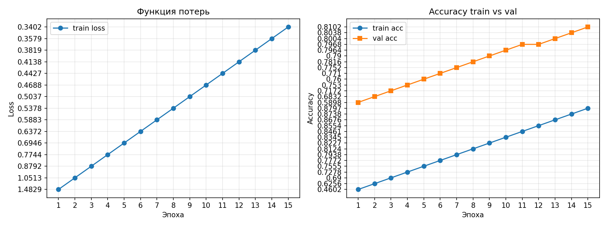
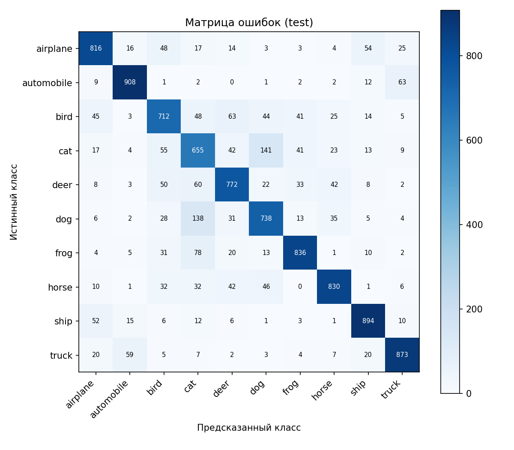

# Лабораторная работа №3 — Классификация изображений на основе свёрточной нейронной сети

## Цель работы

Научиться создавать простые системы классификации изображений на основе свёрточных нейронных сетей (CNN).

В рамках работы решена задача классификации изображений **CIFAR-10** (10 классов): самолёт, автомобиль, птица, кошка, олень, собака, лягушка, лошадь, корабль, грузовик.

---

## 1. Теоретическая база

**Свёрточная нейронная сеть (CNN)** — класс нейронных сетей, специально разработанных для работы с данными, имеющими пространственную структуру (изображения, сигналы). Ключевые компоненты:

- **Свёрточный слой (Conv2d)** — применяет к изображению набор обучаемых фильтров (ядер). Каждый фильтр сканирует изображение с шагом и вычисляет скалярное произведение с локальной областью, выделяя локальные признаки (края, текстуры, узоры). Параметры фильтра общие для всего изображения, что резко сокращает число обучаемых параметров по сравнению с полносвязными слоями.
- **Функция активации ReLU** — `ReLU(x) = max(0, x)` вносит нелинейность; без неё стопка линейных операций сводилась бы к одному линейному преобразованию.
- **Подвыборочный слой (MaxPooling)** — уменьшает пространственную размерность (например, 2×2 → в 2 раза), снижает вычислительную нагрузку и даёт определённую инвариантность к небольшим сдвигам.
- **Полносвязный (классификатор) слой** — на основе извлечённых признаков выдаёт логиты (оценки) для каждого класса. Для 10 классов — слой `Linear(…, 10)`.
- **Softmax** — превращает логиты в вероятности по классам (используется неявно внутри `CrossEntropyLoss`).

**Функция потерь: CrossEntropyLoss** — логарифмическая потеря для многоклассовой классификации: `L = -log(p_y)`, где `p_y` — предсказанная моделью вероятность истинного класса. Минимизация потери эквивалентна максимизации вероятности правильного класса.

**Оптимизатор: Adam** — адаптивный алгоритм градиентного спуска с индивидуальной скоростью обучения для каждого параметра (оценки первого и второго моментов градиента).

**Метрика качества: Accuracy** — доля верно классифицированных изображений. Дополнительно для анализа используются precision, recall, F1-score и матрица ошибок.

**Переобучение (overfitting)** — ситуация, когда модель запоминает обучающую выборку и плохо обобщается на новые данные. Признак — большой разрыв между accuracy на обучении и на валидации, а также рост потерь на валидации после периода снижения.

---

## 2. Описание разработанной системы

### Постановка задачи

- **Классы:** 10 (CIFAR-10).
- **Данные:** torchvision.datasets.CIFAR10 — 50 000 обучающих изображений, 10 000 тестовых.
  - Обучающая выборка (train): 45 000 (90 %)
  - Валидационная выборка (val): 5 000 (10 %, выделено из train)
  - Тестовая выборка (test): 10 000 (требование «не менее 50 изображений» выполнено с запасом)
- **Изображения:** цветные, размер 32×32×3.

### Архитектура сети (SimpleCNN)

| Слой | Детали | Выход |
|------|--------|-------|
| Conv2d | 3→32, ядро 3×3, padding 1 | 32×32×32 |
| ReLU | — | — |
| Conv2d | 32→32, ядро 3×3, padding 1 | 32×32×32 |
| ReLU | — | — |
| MaxPool2d | окно 2×2 | 16×16×32 |
| Conv2d | 32→64, ядро 3×3, padding 1 | 16×16×64 |
| ReLU | — | — |
| Conv2d | 64→64, ядро 3×3, padding 1 | 16×16×64 |
| ReLU | — | — |
| MaxPool2d | окно 2×2 | 8×8×64 |
| Flatten | — | 4096 |
| Linear | 4096→512 | 512 |
| ReLU + Dropout(0.5) | регуляризация | 512 |
| Linear | 512→10 | 10 |

Общее число параметров ≈ 2,2 млн.

### Принцип работы

1. Изображение 32×32×3 подаётся на вход сети.
2. Свёрточные блоки извлекают иерархию признаков (от простых краёв до сложных объектов).
3. MaxPooling сжимает карты признаков.
4. Полносвязный классификатор выдаёт логиты по 10 классам.
5. Предсказание = `argmax` логитов; в обучении логиты подаются в `CrossEntropyLoss`.

### Гиперпараметры обучения

- Loss: `CrossEntropyLoss`
- Оптимизатор: `Adam`, lr = 1e-3
- Batch size: 128
- Эпох: 15
- Аугментация: случайный горизонтальный отражение (RandomHorizontalFlip)
- Нормализация: mean/std по каналам CIFAR-10

### Системные требования

- Python 3.9+
- PyTorch 2.8, TorchVision 0.23
- matplotlib, scikit-learn
- Работает на CPU; обучение 15 эпох заняло ~20 минут на Apple Silicon (MacBook).

### Структура проекта

```
SKI_3/
├── .venv/                 # виртуальное окружение Python
├── data/                  # датасет CIFAR-10
├── models/cifar10_cnn.pt  # сохранённые веса обученной модели
├── plots/                 # графики (кривые обучения, матрица ошибок)
├── train.py               # обучение сети
├── evaluate.py            # оценка качества и построение графиков
├── requirements.txt       # зависимости
└── README.md              # данный отчёт
```

### Запуск

```bash
# 1. Создание окружения и установка зависимостей
python3 -m venv .venv
.venv/bin/pip install -r requirements.txt

# 2. Обучение модели (скачает CIFAR-10 автоматически)
.venv/bin/python train.py --epochs 15

# 3. Оценка качества на валидационной и тестовой выборках
.venv/bin/python evaluate.py
```

---

## 3. Результаты работы и тестирования системы

### Динамика обучения (15 эпох)

| Эпоха | train_loss | train_acc | val_acc |
|-------|-----------|-----------|---------|
| 1  | 1.4829 | 0.4602 | 0.5898 |
| 5  | 0.6946 | 0.7555 | 0.7600 |
| 10 | 0.4688 | 0.8345 | 0.7964 |
| 15 | 0.3402 | 0.8797 | **0.8102** |

Кривые обучения (функция потерь и accuracy):



### Итоговые метрики

| Метрика | Значение |
|---------|----------|
| Accuracy на валидационной выборке | **0.8140** |
| Accuracy на тестовой выборке | **0.8034** (n = 10 000) |
| Macro avg F1 | 0.80 |

**Отчёт по классам (тестовая выборка):**

| Класс | Precision | Recall | F1 |
|-------|-----------|--------|----|
| airplane | 0.83 | 0.82 | 0.82 |
| automobile | 0.89 | 0.91 | 0.90 |
| bird | 0.74 | 0.71 | 0.72 |
| cat | 0.62 | 0.66 | 0.64 |
| deer | 0.78 | 0.77 | 0.78 |
| dog | 0.73 | 0.74 | 0.73 |
| frog | 0.86 | 0.84 | 0.85 |
| horse | 0.86 | 0.83 | 0.84 |
| ship | 0.87 | 0.89 | 0.88 |
| truck | 0.87 | 0.87 | 0.87 |

Матрица ошибок на тестовой выборке:



### Закономерности и проверка переобучения

- Функция потерь монотонно убывает (1.48 → 0.34), train и val accuracy растут от эпохи к эпохе.
- **Разрыв train/val accuracy** на последней эпохе: 0.8797 против 0.8102 (≈ 7 п.п.). Это умеренный признак переобучения — модель запоминает обучающие данные лучше, чем обобщает. Однако:
  - val accuracy продолжает расти и на 15-й эпохе (0.7968 → 0.8004 → 0.8038 → 0.8102), т.е. сеть ещё не достигла предела обобщения;
  - валидационная потеря не растёт (в противном случае переобучение было бы явным).
- Смягчению переобучения способствовали Dropout(0.5) и аугментация (горизонтальный отражение).
- **Сложный класс — «кошка»** (F1 = 0.64): типичный случай для CIFAR-10, кошки визуально схожи с собаками и обладают высокой внутриклассовой вариативностью.
- **Лучший класс — «автомобиль»** (F1 = 0.90): объект с чёткими геометрическими признаками, легко отделяется от остальных.

---

## 4. Выводы по работе

1. Создана и обучена свёрточная нейронная сеть для классификации 10 классов изображений CIFAR-10.
2. Модель достигла **80 % точности на тестовой выборке** (10 000 изображений), что является хорошим результатом для небольшой CNN без предобученных весов, обученной «с нуля» на CPU.
3. Проверка на переобучение показала умеренный разрыв между train (0.88) и val (0.81) accuracy — модель не критически переобучена; валидационная точность продолжает расти к концу обучения, поэтому результат можно улучшить увеличением числа эпох, усилением аугментации или использованием предобученной модели (transfer learning).
4. Архитектура «два свёрточных блока + полносвязный классификатор» даёт разумный баланс точности и вычислительных затрат для учебной задачи.
5. Наибольшие трудности модель испытывает на визуально похожих и вариативных классах (кошки), что соответствует ожиданиям для данного датасета.

---

## 5. Использованные источники

1. Krizhevsky, A. — *Learning Multiple Layers of Features from Tiny Images* (CIFAR-10 dataset), 2009.
2. LeCun, Y. et al. — *Gradient-Based Learning Applied to Document Recognition* (архитектура LeNet-5), 1998.
3. PyTorch Documentation — https://pytorch.org/docs/stable/
4. TorchVision Datasets — https://pytorch.org/vision/stable/datasets.html
5. Goodfellow, I., Bengio, Y., Courville, A. — *Deep Learning*, MIT Press, 2016.